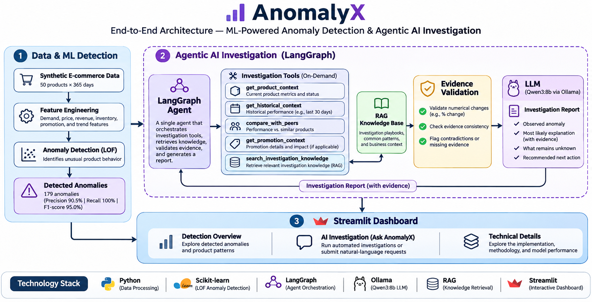
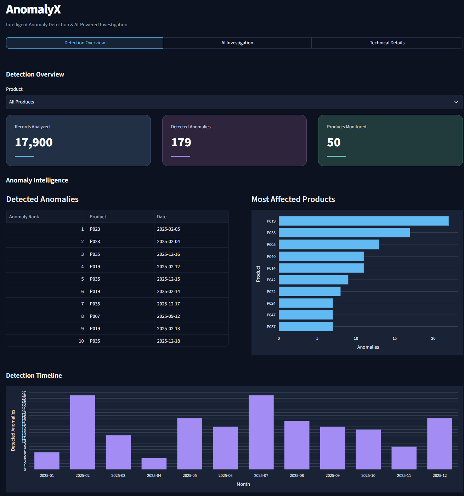
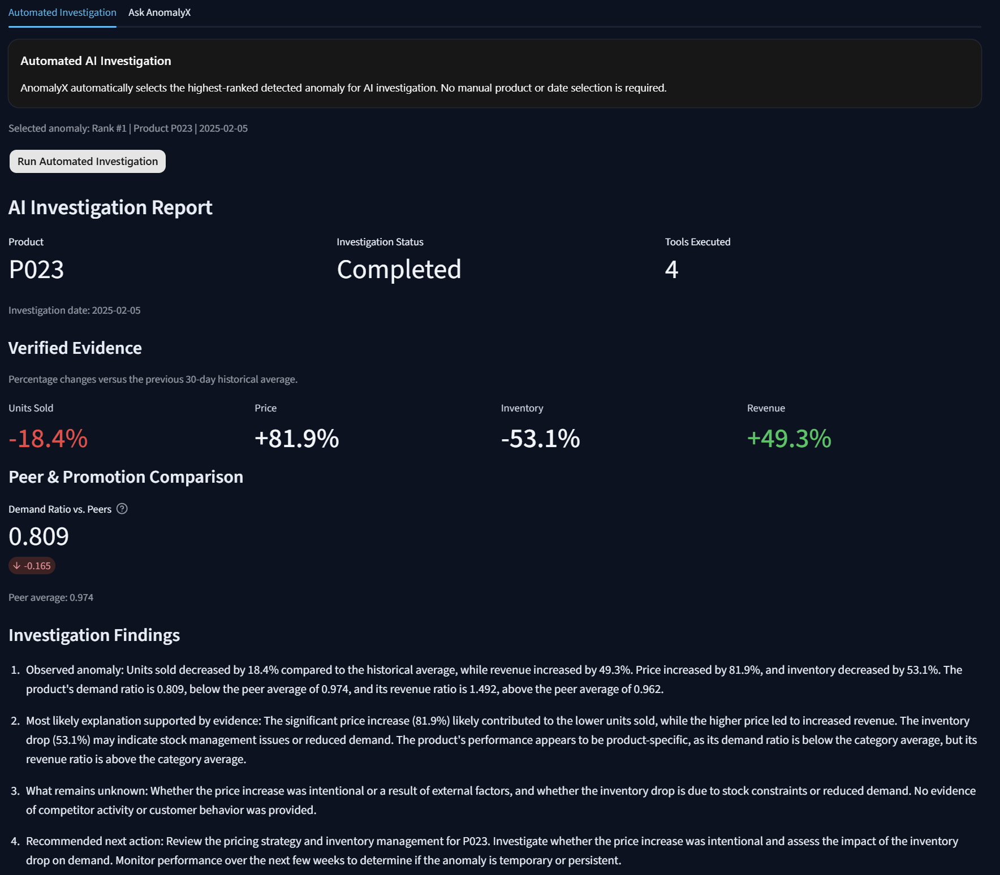

# AnomalyX: ML Powered Anomaly Detection & Agentic AI Investigation


An end-to-end AI application combining **Machine Learning, LangGraph, a local LLM and Retrieval Augmented Generation (RAG)** to detect and investigate unusual e-commerce behavior.


## Overview


AnomalyX goes beyond anomaly detection by investigating unusual product behavior using structured business evidence, historical comparisons, peer analysis and relevant investigation knowledge.


The project demonstrates how traditional Machine Learning and Agentic AI can work together to transform detected anomalies into actionable investigation reports.


## Key Features


- **ML-Based Detection:** Local Outlier Factor (LOF) identifies unusual product behavior.

- **Agentic Investigation:** A single LangGraph agent orchestrates investigation tools and generates reports.

- **Local LLM:** Qwen3:8b via Ollama provides evidence-grounded explanations.

- **Retrieval-Augmented Generation (RAG):** Retrieves relevant information from a local investigation knowledge base.

- **Evidence Validation:** Deterministic Python checks calculate numerical changes and identify inconsistencies.

- **Interactive Dashboard:** Streamlit provides detection insights, automated investigations and natural language investigation requests.


## Architecture





The architecture connects ML based detection with a single agent investigation workflow, evidence validation, local knowledge retrieval and an interactive dashboard.


## Machine Learning Performance


The LOF model was evaluated using labeled synthetic anomalies.


| Metric | Result |
|---|---:|
| Records analyzed | 17,900 |
| Products monitored | 50 |
| Detected anomalies | 179 |
| Precision | 90.5% |
| Recall | 100% |
| F1-score | 95.0% |


The dataset covers 50 products over 365 days and includes simulated demand changes, price changes, promotion underperformance and stockouts.


## Agentic AI Investigation


AnomalyX implements a **single-agent architecture using LangGraph** supported by five investigation tools:


| Tool | Purpose |
|---|---:|
| `get_product_context` | Retrieve current product metrics and status |
| `get_historical_context` | Compare current behavior with historical performance |
| `compare_with_peers` | Compare the product against similar products |
| `get_promotion_context` | Investigate promotion activity when relevant |
| `search_investigation_knowledge` | Retrieve relevant investigation knowledge using RAG |


The investigation workflow includes tool-result caching, execution limits, required-evidence checks and numerical evidence validation.


Each investigation produces four sections:


1. **Observed anomaly**

2. **Most likely explanation supported by evidence**

3. **What remains unknown**

4. **Recommended next action**


## Technology Stack


| Component | Technology |
|---|---:|
| Data processing | Python, Pandas, NumPy |
| Anomaly detection | Scikit-learn, Local Outlier Factor |
| Agent orchestration | LangGraph |
| Local LLM | Qwen3:8b via Ollama |
| Knowledge retrieval | Local RAG |
| Evidence validation | Python |
| Dashboard | Streamlit, Plotly |


## Application Screenshots


### Detection Overview


The dashboard provides a high-level view of detected anomalies, affected products, anomaly rankings and detection trends.





### AI Powered Investigation


AnomalyX automatically investigates detected anomalies, executes relevant tools, validates numerical evidence  and generates a structured AI investigation report.


The example below investigates product **P023 on February 5, 2025** using four tools and comparing its performance against historical and peer baselines.





## Installation and Setup


### 1. Clone the repository


```bash

git clone https://github.com/YOUR_USERNAME/AnomalyX.git

cd AnomalyX

```


Replace `YOUR_USERNAME` with your GitHub username.


### 2. Install dependencies


```bash

pip install -r requirements.txt

```


### 3. Install Ollama


Download and install Ollama from https://ollama.com.


Pull the local language model:


```bash

ollama pull qwen3:8b

```


Ensure Ollama is running before launching an AI investigation.


### 4. Run AnomalyX


The repository includes synthetic e-commerce data, engineered features, and detected anomalies for demonstration.


```bash

streamlit run app.py

```


Open the local Streamlit URL displayed in the terminal.


## How to Use


**Detection Overview:** Explore anomaly rankings, affected products, and detection trends.


**AI Investigation: Automated Investigation:** Run an automated investigation of a detected anomaly.


**AI Investigation: Ask AnomalyX:** Submit natural language requests to investigate specific products and dates.


**Technical Details:** Explore the detection methodology and implementation.


## Example Investigation


For product P023 on February 5, 2025, the verified evidence shows the following changes relative to the previous 30-day historical average:


| Metric | Change |
|---|---:|
| Units sold | −18.4% |
| Price | +81.9% |
| Inventory | −53.1% |
| Revenue | +49.3% |


The product's demand ratio was **0.809**, compared with a peer average of **0.974**.


The investigation report interprets these findings, distinguishes observations from unknowns, and recommends follow-up actions.


## Limitations


- Synthetic data is used for development and evaluation.

- LLM generated explanations may contain speculative causal interpretations despite evidence validation.

- Local inference introduces investigation latency.

- The application is a proof of concept rather than a production deployed monitoring platform.


## Future Improvements


Potential improvements include evaluation using real-world business data, stronger explanation reliability, and production-oriented monitoring.


---


**AnomalyX demonstrates how Machine Learning, Agentic AI, RAG and deterministic evidence validation can be combined into an end-to-end analytics investigation workflow.**

